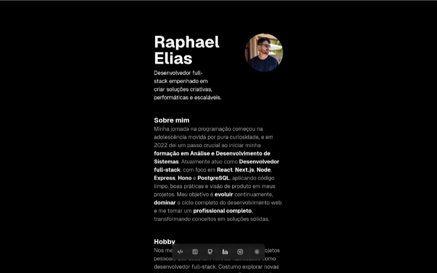

# Portfólio Pessoal - Raphael Elias

[](https://raphaelelias.dev/)

> **Acesse o portfólio:** [https://raphaelelias.dev](https://raphaelelias.dev)

---

## 🚀 Sobre o Projeto

Este é o meu portfólio pessoal, uma plataforma moderna e interativa desenvolvida para apresentar minhas competências, exibir meus projetos mais recentes e compartilhar conhecimento através de posts de blog.

O projeto foi construído com foco em performance, boas práticas de desenvolvimento e uma arquitetura escalável, utilizando as tecnologias mais recentes do ecossistema JavaScript.

### ✨ Principais Funcionalidades

*   **Design Responsivo:** Experiência de usuário otimizada para desktops, tablets e dispositivos móveis.
*   **Integração com APIs Externas:**
    *   **GitHub:** Exibe meus repositórios fixados dinamicamente.
    *   **Hashnode:** Lista minhas postagens de blog mais recentes.
*   **Componentização com Shadcn/UI:** Interface construída com componentes reutilizáveis, customizáveis e acessíveis.
*   **Dark Mode:** Suporte a tema claro e escuro para preferência do usuário.
*   **Qualidade de Código:** Linting e formatação garantidos com Biome e hooks de pre-commit com Husky.

---

## 🛠️ Tecnologias Utilizadas

Este projeto foi construído com uma stack moderna e robusta:

*   **Framework:** [Next.js](https://nextjs.org/) (com Turbopack)
*   **Linguagem:** [TypeScript](https://www.typescriptlang.org/)
*   **UI:** [React](https://react.dev/)
*   **Estilização:** [Tailwind CSS](https://tailwindcss.com/)
*   **Componentes UI:** [Shadcn/UI](https://ui.shadcn.com/)
*   **Lint & Formatação:** [Biome](https://biomejs.dev/)
*   **Gerenciador de Pacotes:** [pnpm](https://pnpm.io/)
*   **Hooks de Git:** [Husky](https://typicode.github.io/husky/)

---

## ⚙️ Como Executar o Projeto Localmente

Se você é um desenvolvedor e deseja explorar o código-fonte, siga os passos abaixo.

### Pré-requisitos

*   [Node.js](https://nodejs.org/) (versão 20.x ou superior)
*   [pnpm](https://pnpm.io/)

### Instalação e Execução

1.  **Clone o repositório:**
    ```bash
    git clone https://github.com/raphaeleliass/portfolio.git
    cd portfolio
    ```

2.  **Instale as dependências:**
    ```bash
    pnpm install
    ```

3.  **Inicie o servidor de desenvolvimento:**
    ```bash
    pnpm dev
    ```
    Acesse [`http://localhost:3000`](http://localhost:3000) no seu navegador.

### Outros Comandos

*   **Build para Produção:**
    ```bash
    pnpm build
    ```

*   **Iniciar Servidor de Produção:**
    ```bash
    pnpm start
    ```

*   **Verificar Lint e Formatação:**
    ```bash
    pnpm check
    ```
---

## 🗂️ Estrutura do Projeto

O código está organizado de forma a promover a separação de responsabilidades e facilitar a manutenção:

```
src/
├── app/            # Páginas e layouts principais da aplicação (Next.js App Router)
├── components/     # Componentes React reutilizáveis
│   ├── layout/     # Componentes de estrutura (seções da página)
│   └── ui/         # Componentes de UI genéricos (botões, badges, etc.)
├── data/           # Dados estáticos ou mocks
├── lib/            # Funções utilitárias e helpers
├── services/       # Lógica de integração com APIs externas (GitHub, Hashnode)
└── types/          # Definições de tipos TypeScript
```

---

## 📫 Contato

**Raphael Elias**

*   **LinkedIn:** [https://www.linkedin.com/in/raphaeleliass](https://www.linkedin.com/in/raphaeleliass)
*   **GitHub:** [https://github.com/raphaeleliass](https://github.com/raphaeleliass)


